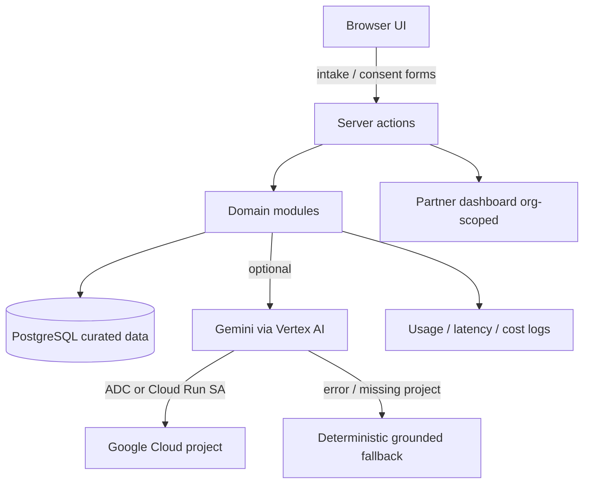

# AccessPath AI — architecture

## Modular monolith

```
src/
  app/                 Next.js App Router (UI + thin actions/routes)
  components/          Accessible UI primitives + journey components
  lib/                 env, db, constants, partner auth
  modules/             Domain logic (resources, intakes, plans, ai, consent, cases)
```

## Request flow



## Grounding rule

Factual claims about providers, schemes, costs, and requirements are
rendered only from curated `resources` / `assistance_programs` rows.
The model may reorder language; it may **not** invent IDs, URLs, prices,
or eligibility decisions. Server code filters expired/unverified records
and validates structured JSON.

## Auth model (MVP)

| Surface | Auth |
| --- | --- |
| Public journey | No login |
| Partner dashboard | Optional `DEMO_PARTNER_ACCESS_TOKEN` cookie gate |
| Vertex AI | ADC locally; dedicated least-privilege SA on Cloud Run |

## Deployment

Cloud Run container (`Dockerfile`) + Cloud SQL Postgres + Secret Manager
for `DATABASE_URL`. See [DEPLOYMENT.md](./DEPLOYMENT.md).
